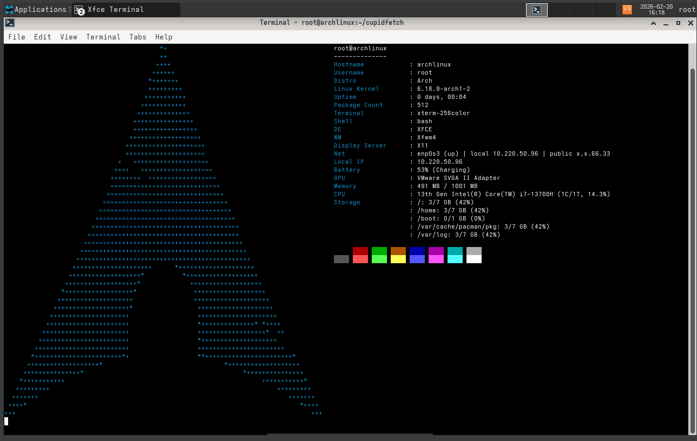

# cupidfetch

cupidfetch is a system information tool written in C for Linux and Windows. It's a hobby project for learning C, named after Cupid the cat.


It displays system details alongside distro ASCII art, with a JSON mode for scripts.



## Quickstart

On Linux, install a C compiler, Make, and Git, then run:

```sh
git clone https://github.com/cupidthecat/cupidfetch
cd cupidfetch
make
./cupidfetch
```

Use `./cupidfetch --json` for JSON output. To install the sample configuration, run `sh ./install-config.sh`; existing configs are left unchanged.

## Documentation

- [Build and run on Linux or Windows](docs/usage.md#build-and-run)
- [Configuration and modules](docs/usage.md#configuration)
- [Tests and performance checks](docs/usage.md#tests-and-debugging)
- [Distro detection and logos](docs/usage.md#distro-detection-and-logos)
- [Maintenance and validation](docs/maintenance.md)

The project is still in development. Contributions and questions are welcome in [Discord](https://discord.gg/698GBkg2KR).

## License

[GNU General Public License 2.0 or later](LICENSE).
