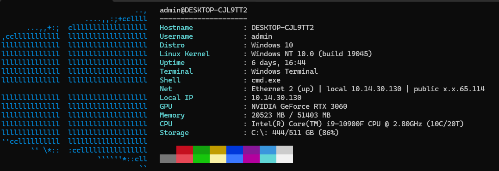

# Using cupidfetch

[Back to the README](../README.md)

## Build and run

cupidfetch targets Linux and Windows 10/11. You need a C compiler (GCC is recommended), Git to clone the repository, and Make for the Linux build. The bundled cupidconf library handles configuration; you don't need to install it separately.

### Linux

On Debian or Ubuntu, install the build tools with:

```sh
sudo apt update && sudo apt install build-essential git
```

Clone and build from the repository root:

```sh
git clone https://github.com/cupidthecat/cupidfetch
cd cupidfetch
make
./cupidfetch
```

The default build uses `-O2 -DNDEBUG`. To change the optimization flags:

```sh
make clean
make CUPID_OPT='-O3 -march=native'
```

Keep the executable with the repository's `data` directory. Runtime distro definitions are read from `data/distros.def` beside the executable, so moving just the binary to `/usr/local/bin` changes where it looks for that file. There is no `make install` target yet.

### Windows

With MinGW GCC, build in PowerShell from the repository root:

```powershell
$src = Get-ChildItem -Recurse -File src -Filter *.c | ForEach-Object { $_.FullName }
gcc -o cupidfetch.exe $src libs/cupidconf.c -O2 -DNDEBUG -Ilibs -D_WIN32_WINNT=0x0601 -lws2_32
.\cupidfetch.exe
.\cupidfetch.exe --json
```

If your Windows build environment includes Make and the shell utilities used by the Makefile:

```sh
make windows
```



### Command-line options

- `--json` prints a single JSON object and exits without clearing the screen or entering the resize loop.
- Plain output redirected to a file or pipe renders once and exits. Interactive terminals retain resize updates.
- `--force-distro <name>` overrides the detected distro for display and logo testing.
- `-h` or `--help` shows usage.

```sh
./cupidfetch --json
./cupidfetch --force-distro ubuntu
```

## Configuration

Run the installer from the repository root:

```sh
sh ./install-config.sh
```

It asks you to press Enter before continuing. It reads the template from [data/cupidfetch.ini](../data/cupidfetch.ini) relative to the script, so you can also invoke the script by path from another directory. Existing configs are left unchanged. Keep the script and its `data` directory together.

On Linux, the config path is `${XDG_CONFIG_HOME}/cupidfetch/cupidfetch.conf` when `XDG_CONFIG_HOME` is nonempty, otherwise `$HOME/.config/cupidfetch/cupidfetch.conf`.

On Windows, the application checks `XDG_CONFIG_HOME` first, then `%APPDATA%/cupidfetch/cupidfetch.conf`, and falls back to the home directory's `.config/cupidfetch/cupidfetch.conf`. The shell installer uses `XDG_CONFIG_HOME` or `HOME`; it does not select `APPDATA` automatically. You can copy the template to the application's config path manually.

Without a config file, cupidfetch uses its built-in defaults.

### Example config

The `modules` list controls which modules run and their display order. Keep it before the first section header:

```ini
# List of modules (space-separated)
modules = hostname username distro linux_kernel uptime pkg term shell de wm theme icons display_server net ip battery gpu memory cpu storage

[memory]
unit-str = MB
unit-size = 1000000

[storage]
unit-str = GB
unit-size = 1000000000

[network]
# false = mask public IP (default), true = show full public IP
show-full-public-ip = false
```

Dotted keys are also supported. These settings are equivalent to the sections above:

```ini
memory.unit-str = MB
memory.unit-size = 1000000
storage.unit-str = GB
storage.unit-size = 1000000000
network.show-full-public-ip = false
```

Dotted keys are absolute even inside a section. A bare key inside `[memory]`, for example, gets the `memory.` prefix. An empty section header (`[]`) returns to top-level keys. If a setting appears more than once, the last value wins.

Lines may contain up to 1,023 bytes before the newline. Longer lines and lines containing a NUL byte are skipped in full. Blank lines and lines starting with `#` or `;` after whitespace are ignored. Put comments on their own lines for ordinary settings.

Unit sizes must be positive decimal integers that fit in an `unsigned long`. Invalid, zero, negative, and overflowing values leave the current unit size unchanged, normally the built-in default. The label and size are separate settings, so change both when switching units. Built-in defaults use MB (1,000,000 bytes) for memory and GB (1,000,000,000 bytes) for storage; the installer template uses MB for both.

The public-IP flag accepts `true`, `yes`, `on`, or `1`, and `false`, `no`, `off`, or `0`. Words are case-insensitive. Invalid values preserve the current setting.

### Modules

Available modules cover:

- Hostname, username, distro, kernel version, and uptime
- Package count, shell, and terminal
- Desktop environment, window manager, theme, and icons
- Display server (Wayland/X11)
- Network interface state, local IPv4/IPv6 addresses, and public IP
- Battery, GPU, memory usage, CPU model and topology, and CPU usage where available
- Storage usage per mount

The example config lists the module names. Detection depends on the operating system and tools available on the machine. Linux GPU output is omitted when DRM and GPU-filtered lspci detection provide no result. When CPU topology lacks socket/core identifiers, output reports logical threads without inventing a physical core count. Linux terminal output handles window resizing with `SIGWINCH`.

## Tests and debugging

Run from the repository root:

```sh
make test
```

This builds the application and runs the C parser, config, and unit-conversion suites, plus isolated Python CLI and shell installer tests. Python 3 is required for the CLI tests. The CLI checks also require the performance harness to reject invalid numeric budgets. Individual targets are:

- `make test-parsers`: distro definition and `/etc/os-release` ID parsing
- `make test-config`: configuration parsing, module lists, unit sizes, and boolean flags
- `make test-units`: byte-to-unit conversion helpers
- `make test-cli`: command-line and JSON behavior
- `make test-install`: config installation and preservation of existing configs

An [Ubuntu CI workflow](../.github/workflows/ci.yml) runs the checks. Adding the workflow does not establish that a hosted run has passed or that other platforms have been tested.

For builds with sanitizer instrumentation:

```sh
make clean
make asan
./cupidfetch --json
```

Use `make ubsan` for UndefinedBehaviorSanitizer. These targets build an instrumented executable; run it to check the paths you exercise.

### Performance checks

`make test-perf` runs a JSON-mode startup benchmark with a core module profile. It is separate from `make test`. The default budget is a mean runtime of at most 150 ms across 20 runs after warmup.

Adjust the benchmark with environment variables:

- `CUPIDFETCH_PERF_MAX_MEAN_MS`: mean-runtime budget in milliseconds
- `CUPIDFETCH_PERF_RUNS`: measured runs
- `CUPIDFETCH_PERF_WARMUP`: warmup runs

```sh
CUPIDFETCH_PERF_MAX_MEAN_MS=200 CUPIDFETCH_PERF_RUNS=30 make test-perf
```

## Distro detection and logos

Distro definitions include Debian and Ubuntu derivatives, Arch and its derivatives, Fedora, and others listed in [data/distros.def](../data/distros.def). Coverage of a distro name does not guarantee that every module works on it.

On Linux, an unknown distro from `/etc/os-release` triggers a warning and an attempt to add a `DISTRO("shortname", "Capitalized", "")` entry under an `/* auto added */` comment in the runtime `data/distros.def`. If the file can be updated, cupidfetch reloads it. This requires write access to that location.

To add or adjust a distro manually, edit [data/distros.def](../data/distros.def):

```text
DISTRO("ubuntu" , "Ubuntu" , "")
DISTRO("cupidOS", "cupidOS", "")
```

Package counting uses an internal distro-to-package-manager map and direct filesystem or database reads where possible. The command in `distros.def` is a fallback; shell-heavy commands are ignored.

Logos are selected by distro name. Built-in art includes Ubuntu, Debian, Arch, Fedora, Manjaro, Alpine, and Windows 10/11. Terminals advertising `COLORTERM=truecolor` or `COLORTERM=24bit` get distro-tinted 24-bit color. Missing art uses a generic logo.

## Logging

With a terminal on stderr, cupidfetch tries to write `log.txt` beside its config file. If that fails, it logs to stderr. When stderr is redirected, it writes there directly. To suppress those messages:

```sh
cupidfetch 2> /dev/null
```

## Contributing

This is a hobby project for learning and experimentation. Beginners and experienced C programmers are welcome to ask questions, improve detection, or add distro coverage. Join the [Discord](https://discord.gg/698GBkg2KR).

Areas for future work include more distro art, user theming, alignment fixes, optional Nerd Font icons, an install target, an AUR package, and broader desktop-environment and window-manager detection. Wayland detection exists, with room to improve coverage.


